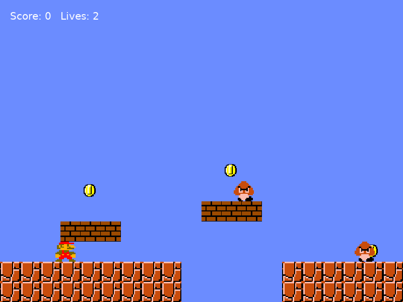

# Super Mario (C++17 / SDL2)

[](https://github.com/magnalorant/super-mario/actions/workflows/ci.yml)

A side-scrolling platformer with a built-in level editor. The project started as a single
1270-line C file; this repository is a complete rewrite in modern C++17 with a testable core,
a thin SDL2 frontend, a CMake build, automated tests and continuous integration.



## Features

- Four levels (three shipped, one custom level created with the editor)
- Walking enemies that turn at walls and ledges, stomping and fireballs
- Coins, mushroom (extra life, breaks blocks from below) and flower (fireballs)
- Horizontally and vertically moving platforms that carry the player
- Goal flag, lives, score, pause and game over screens
- Tile based level editor that saves to `custom_map.txt`

## Requirements

| Tool | Version | Notes |
| --- | --- | --- |
| C++ compiler | C++17 (GCC 9+, Clang 10+) | developed with GCC 13, CI also builds with Clang |
| CMake | 3.20+ (3.25+ for presets) | |
| SDL2, SDL2_image, SDL2_ttf | 2.0.18+ | only needed for the game executable |
| GoogleTest | 1.11+ | optional, fetched automatically if missing |
| Doxygen | 1.9+ | optional, for API documentation |

The reference environment is Ubuntu 24.04 LTS:

```sh
sudo apt install build-essential cmake ninja-build pkg-config \
    libsdl2-dev libsdl2-image-dev libsdl2-ttf-dev libgtest-dev doxygen graphviz
```

## Build and run

Configure, build and run all tests with one command:

```sh
cmake --workflow --preset dev
./build/dev/src/app/super_mario
```

Without presets:

```sh
cmake -S . -B build -DCMAKE_BUILD_TYPE=Release
cmake --build build --parallel
ctest --test-dir build --output-on-failure
./build/src/app/super_mario
```

The game looks for its data in `assets/` next to the executable; the build copies it there.
Use `--assets DIR` to point somewhere else and `--help` for all options.

### Presets

| Preset | Purpose |
| --- | --- |
| `dev` | Debug build of game and tests, warnings are errors |
| `release` | Optimised build for playing |
| `core-only` | Core library and tests without SDL2 |
| `sanitize` | Tests under AddressSanitizer and UndefinedBehaviorSanitizer |
| `coverage` | Tests instrumented for gcov / gcovr |

### CMake options

| Option | Default | Effect |
| --- | --- | --- |
| `MARIO_BUILD_GAME` | `ON` | Build the SDL2 executable |
| `MARIO_BUILD_TESTS` | `ON` | Build the GoogleTest suites and register them with CTest |
| `MARIO_WARNINGS_AS_ERRORS` | `OFF` | Add `-Werror` / `/WX` |
| `MARIO_ENABLE_SANITIZERS` | `OFF` | ASan + UBSan instrumentation |
| `MARIO_ENABLE_COVERAGE` | `OFF` | `--coverage` instrumentation |
| `MARIO_BUILD_DOCS` | `OFF` | Add the `docs` target |

## Controls

| Key | Action |
| --- | --- |
| Arrow keys | Move / navigate menus |
| Up or Space | Jump |
| Left Shift | Shoot a fireball (with flower) |
| P or Esc | Pause / resume |
| M | Back to menu (pause screen and editor) |
| Enter | Confirm |

Editor: number keys `0`-`8` select a tile, left click places it, right click erases,
arrow keys scroll and `S` saves to `assets/levels/custom_map.txt`.

## Level format

A level is a text file with 10 lines of 141 characters:

| Char | Meaning | Char | Meaning |
| --- | --- | --- | --- |
| `0` | empty | `5` | mushroom |
| `1` | wall / ground | `6` | flower |
| `2` | coin | `7` | horizontally moving platform |
| `3` | enemy | `8` | vertically moving platform |
| `4` | goal flag | | |

Short lines and unknown characters are treated as empty space.

## Testing

```sh
ctest --preset dev                 # everything
ctest --preset dev -L unit         # unit tests only
ctest --preset dev -L integration  # shipped level checks
ctest --preset dev -L smoke        # runs the real executable headless
cmake --workflow --preset core-only
cmake --preset sanitize && cmake --build --preset sanitize && ctest --preset sanitize
```

Coverage report (requires `gcovr`):

```sh
cmake --preset coverage && cmake --build --preset coverage && ctest --preset coverage
gcovr --root . --filter src/ --filter include/ build/coverage --html-details coverage/index.html
```

See [docs/design.md](docs/design.md) for what is and is not covered by the tests.

## Code quality

- `clang-format --dry-run --Werror $(git ls-files '*.cpp' '*.hpp')` checks the style in `.clang-format`
- `clang-tidy -p build/dev src/core/*.cpp src/states/*.cpp src/app/*.cpp` runs the checks in `.clang-tidy`
- GitHub Actions runs GCC and Clang builds, sanitizers, coverage, formatting, clang-tidy and Doxygen on every push

## Documentation

```sh
cmake --preset dev -DMARIO_BUILD_DOCS=ON
cmake --build --preset dev --target docs
xdg-open build/dev/docs/html/index.html
```

## Project layout

```
include/mario/core/    game logic headers (no SDL dependency)
include/mario/states/  Game context and screen states
src/core/              game logic implementation
src/states/            state implementations
src/app/               SDL2 frontend and main()
tests/unit/            unit tests
tests/integration/     tests against the shipped levels
tests/support/         test helpers (level builder, fake renderer)
assets/                levels, sprites and font
cmake/                 reusable CMake modules
docs/                  design notes and Doxygen setup
```

## Credits

The font is DejaVu Sans (Bitstream Vera / DejaVu license). Sprites and level files are carried
over from the original C version of the project.
